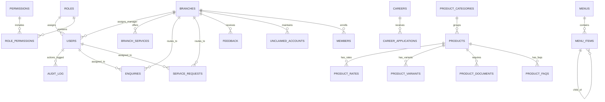

# Entity-Relationship Documentation (ERD)

This document describes the relational architecture of the Services Co-operative Bank / Society multi-tenant white-label platform.

## Core Relational Tables & Descriptions

### 1. RBAC & Identity
* **`roles`**: System roles (`super_admin`, `admin`, `editor`, `branch_manager`).
* **`permissions`**: Granular capability keys (e.g. `rates.edit`, `branches.manage`, `enquiries.view`).
* **`role_permissions`**: Mapping table between roles and permissions.
* **`users`**: Administrative and operational users scoped by `client_slug` and optional `branch_id`.

### 2. Physical Network
* **`branches`**: Full branch directory with bilingual metadata (names, addresses, timings), coordinates (lat/lng), manager details, and service capability flags (`has_locker`, `has_365_days`, `has_gold_loan`, `has_atm`).
* **`branch_services`**: Many-to-many relationship of specific services provided per branch.

### 3. Products & Unified Rate Engine
* **`product_categories`**: Hierarchical grouping (`loan`, `deposit`, `facility`, `welfare`).
* **`products`**: Rich financial product profiles with eligibility, processing charges, tenure, and regulatory audience target (`members_only` vs `open_to_public`).
* **`product_rates`**: Rate engine records with `general_rate`, `senior_rate`, `effective_from`, and `effective_to` dates.
* **`product_variants`**: Specific scheme variants (e.g. Gold Loan schemes: Normal, Express, Super, Agriculture).
* **`product_documents`**: Mandatory and optional KYC/security document requirements.
* **`product_faqs`**: Bilingual product-specific Q&A.

### 4. Interactive Enquiries & Compliance Workflows
* **`enquiries`**: General customer enquiries with unique tracking codes and branch routing.
* **`service_requests`**: Member service requests (New Account, Locker, Loan, Statement, Complaint) with file attachment support and status lifecycles.
* **`feedback`**: Customer service satisfaction ratings (1-5 stars) and comments.
* **`callback_requests`**: Quick callback requests with preferred time windows.
* **`audit_log`**: Security trace of all administrative updates with IP, user, and payload details.
